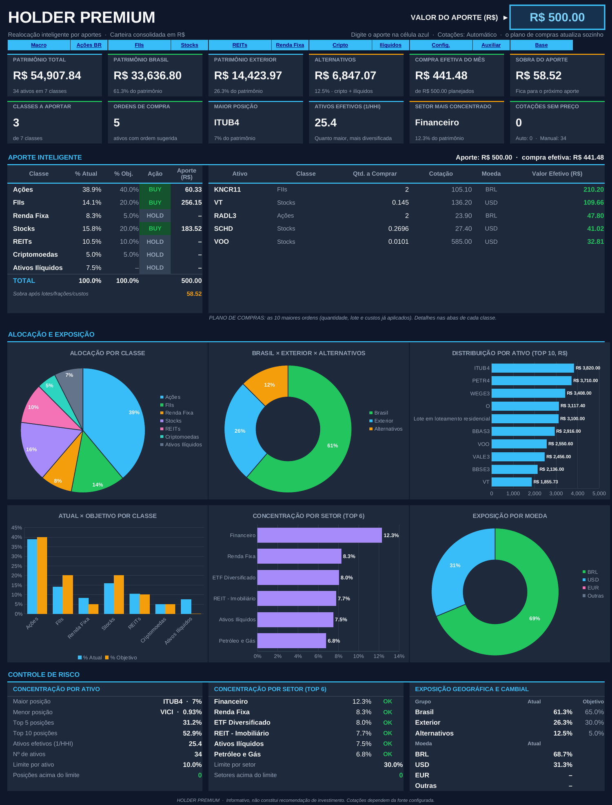
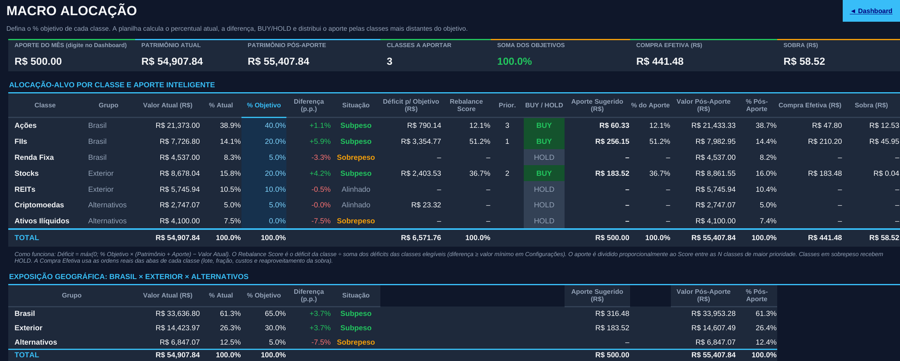
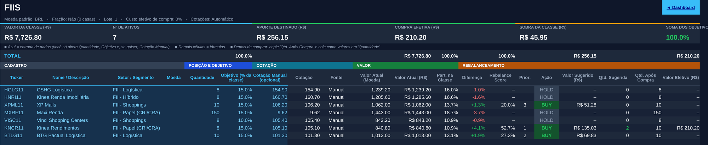

<div align="center">

# 📊 HOLDER Asset Allocation

### Planilhas de realocação inteligente por aportes

**Digite o valor do aporte. A planilha diz o que comprar e quanto.** 🛒

[](#-compatibilidade)
[](#-compatibilidade)


<br>



</div>

---

## 🎯 O problema

Todo mês surge a mesma pergunta: **"com o dinheiro que vou investir agora, o que eu compro e quanto?"**

Fazer a conta na mão (ou no olho) costuma dar em compras aleatórias e uma carteira que vai se afastando dos percentuais planejados. Estas planilhas resolvem isso: você define **para onde quer ir**, e elas calculam **o melhor uso do próximo aporte para chegar lá**, **sem precisar vender nada**.

## ⚙️ Como funciona

1. **Defina os objetivos**: o % de cada classe (Ações, FIIs, Renda Fixa, Stocks, REITs, Criptomoedas, Ativos Ilíquidos) e o % de cada ativo dentro da classe.
2. **Informe o que você tem** (ticker e quantidade) e o **valor do aporte**.
3. **A planilha calcula** o quanto cada classe e cada ativo está distante do objetivo (o **Rebalance Score**) e divide o aporte por prioridade.
4. **Você recebe o plano de compras**: ativo, quantidade e valor de cada ordem, já com **lote/fração, corretagem, IOF e spread** aplicados.
5. **Compre no home broker**, volte e atualize as quantidades. Pronto.

```text
Déficit  = máximo(0 ; Objetivo × (Patrimônio + Aporte) − Valor Atual)
Score    = Déficit do item ÷ soma dos déficits dos itens elegíveis
Aporte do item = Aporte × Score
```

> Quanto mais distante do objetivo, maior a prioridade de compra. Itens acima do alvo recebem **HOLD**. O que não coube nas ordens (cotas inteiras, lote, custos) é **reaproveitado** no ativo de maior prioridade que ainda puder ser comprado.

## 🗂️ Qual versão escolher?

| | 🎯 **Simplificada** | 🏦 **Premium (completa)** |
|---|---|---|
| **Foco** | Só **realocação por aporte** | **Gestão patrimonial completa** + realocação |
| **Fluxo** | Digita o aporte → vê o plano → compra → atualiza quantidades | O mesmo, mais controle de aportes, dividendos e histórico |
| **Valor do aporte** | Célula azul no topo do Dashboard | Em Configurações |
| **Preço médio, rentabilidade** | ❌ (use MyProfit ou similar) | ✅ |
| **Dividendos, DY, Yield on Cost** | ❌ | ✅ |
| **Histórico patrimonial e de aportes** | ❌ | ✅ (até 10 anos) |
| **Abas** | 12 | 15 |
| **Ideal para** | Quem já acompanha o resto em outro app e quer **só** o plano de compras | Quem quer **tudo numa planilha só** |
| **Manual** | 14 páginas | 24 páginas |
| **Pasta** | [📁 Versão Simplificada](Vers%C3%A3o%20Simplificada) | [📁 Versão PREMIUM](Vers%C3%A3o%20PREMIUM) |

> 💡 **Na dúvida, comece pela Simplificada.** Ela é mais leve e resolve a pergunta do mês. Dá para migrar para a Premium depois.

## 🖼️ Prévia

**Macro Alocação** (objetivos por classe e distribuição do aporte):



**Aba de ativos** (você preenche as colunas azuis; o resto é automático):



<details>
<summary>📈 Ver o Dashboard da versão Premium</summary>

<br>


</details>

## 🚀 Comece em 5 minutos

1. Entre na pasta da versão que escolheu e **baixe os arquivos** (clique no arquivo → botão de download).
2. Abra primeiro a **versão DEMO** (carteira fictícia) para ver tudo funcionando.
3. No Excel, clique em **Habilitar Edição** se aparecer o aviso amarelo.
4. Depois, abra a **versão limpa** e siga o manual em PDF da sua pasta.
5. Para atualizar as cotações: **Ctrl + Alt + F9** (Excel) ou **Ctrl + Shift + F9** (LibreOffice).

## ✨ Destaques

- **Rebalance Score**: prioridade proporcional à distância do objetivo, em classes e em ativos.
- **7 classes** em 3 grupos: Brasil (Ações, FIIs, Renda Fixa), Exterior (Stocks, REITs) e Alternativos (Criptomoedas, Ativos Ilíquidos).
- **Ordens realistas**: lote, fração, corretagem, IOF, spread, compra mínima e reaproveitamento da sobra.
- **Multimoeda**: BRL, USD, EUR, GBP, CAD, CHF, JPY, AUD e mais duas moedas livres.
- **Cotações automáticas** (Yahoo Finance; CoinGecko opcional para cripto), com **plano B manual**.
- **Controle de risco**: concentração por ativo, setor, geografia e moeda, com alertas configuráveis.
- **Dashboard** com indicadores, plano de compras e 6 gráficos.
- **Sem macros**, tudo em fórmulas abertas e auditáveis. Até **920 posições**.

## 🧪 Exemplo rápido (arquivo DEMO)

Carteira fictícia de **R$ 54.907,84**, aporte de **R$ 500**, objetivos 40 / 20 / 20 / 10 / 5 / 5 / 0:

| Classe | % Atual | % Objetivo | Situação | Aporte sugerido |
|---|---:|---:|---|---:|
| Ações | 38,9% | 40% | Subpeso | **R$ 60,33** |
| FIIs | 14,1% | 20% | Subpeso | **R$ 256,15** |
| Stocks | 15,8% | 20% | Subpeso | **R$ 183,52** |
| Renda Fixa, REITs, Cripto, Ilíquidos | – | – | Alinhado / Sobrepeso | HOLD |

Plano de compras resultante: `KNCR11 × 2`, `VT × 0,145`, `RADL3 × 2`, `SCHD × 0,2696`, `VOO × 0,0101`. Compra efetiva de **R$ 441,48** e sobra de **R$ 58,52**, que fica para o próximo aporte.

> ⚠️ Os ativos, quantidades e preços da DEMO são **fictícios e ilustrativos**. Não são recomendação.

## 🔌 Cotações

| Mercado | Você digita | A planilha consulta |
|---|---|---|
| Ações / FIIs | `PETR4`, `HGLG11` | `PETR4.SA`, `HGLG11.SA` |
| Stocks / REITs | `AAPL`, `VOO`, `O` | o mesmo ticker |
| Cripto | `BTC`, `ETH` | `BTC-USD` (ou CoinGecko pelo ID) |
| Câmbio | par em Configurações | `BRL=X` (dólar) etc. |

Se a internet ou a API falharem, entra a **Cotação Manual** que você deixou preenchida. Sem ela, a coluna **Fonte** avisa "Sem cotação".

## ✅ Compatibilidade

- Desenvolvida para **Excel 365** e **LibreOffice Calc**.
- Os cálculos foram validados de forma automatizada no **LibreOffice** (zero erros de fórmula). Relatos de uso no Excel são muito bem-vindos: abra uma [Issue](../../issues).
- A cotação automática usa a função `WEBSERVICE`: funciona no **Excel para Windows** e no **LibreOffice**. No **Excel para Mac e Excel na Web**, use o **modo Manual**.

## ⚠️ Limitações (transparência em primeiro lugar)

- As cotações dependem de serviços de terceiros (Yahoo Finance e CoinGecko), que podem limitar consultas, mudar de formato ou ficar fora do ar.
- O **IOF** e o **spread** padrão vêm da planilha original que inspirou o projeto. **Confirme as alíquotas e custos com a sua corretora.**
- Na **Renda Fixa** e nos **Ilíquidos** não há cotação automática: você atualiza o **Valor Atual**.
- A planilha **sugere**, não executa: a compra e a atualização das quantidades são suas.
- Na versão Premium, o histórico patrimonial é registrado por você, uma vez por mês.

## ❓ FAQ

<details>
<summary><b>Ela manda vender algum ativo?</b></summary>

Não. O rebalanceamento é feito **só com aportes novos**. Itens acima do objetivo ficam em HOLD.
</details>

<details>
<summary><b>Preciso habilitar macros?</b></summary>

Não. O arquivo não usa macros. Basta habilitar a edição, se o Excel pedir.
</details>

<details>
<summary><b>Funciona no Mac e no celular?</b></summary>

No Excel para Mac e na Web, funciona com **cotações em modo Manual**. No LibreOffice (Windows, Mac e Linux), funciona normalmente, inclusive a cotação automática.
</details>

<details>
<summary><b>Posso mudar os percentuais depois?</b></summary>

Pode, quando quiser. Mudanças frequentes geram compras desnecessárias, então o ideal é revisar a cada 3 a 6 meses.
</details>

<details>
<summary><b>Ela recomenda quais ativos comprar?</b></summary>

Não. **Você escolhe os ativos e os percentuais.** A planilha só calcula como distribuir o aporte para chegar lá.
</details>

<details>
<summary><b>Posso apagar uma linha de ativo?</b></summary>

Não apague a **linha**. Selecione apenas as **células azuis** da linha e aperte Delete. Excluir linhas quebra as fórmulas.
</details>

## 📂 Estrutura do repositório

```text
holder-asset-allocation/
├── README.md                  ← você está aqui
├── docs/img/                  ← imagens deste README
├── Versão Simplificada/       ← só realocação por aportes (12 abas)
│   ├── README.md
│   ├── HOLDER_PREMIUM_Simplificada.xlsx
│   ├── HOLDER_PREMIUM_Simplificada_DEMO.xlsx
│   └── HOLDER_PREMIUM_Simplificada_Manual.pdf
└── Versão PREMIUM/            ← gestão patrimonial completa (15 abas)
    ├── README.md
    ├── HOLDER_PREMIUM.xlsx
    ├── HOLDER_PREMIUM_DEMO.xlsx
    └── HOLDER_PREMIUM_Manual_de_Preenchimento.pdf
```

## 🤝 Feedback e contribuições

Achou um bug, teve uma ideia ou quer uma classe de ativo nova? 💬

- Abra uma [Issue](../../issues) descrevendo o que aconteceu (versão da planilha, programa usado e, se possível, uma captura de tela).
- **Nunca anexe a planilha com os dados da sua carteira real.** Use a DEMO para reproduzir o problema.
- Se a planilha ajudou, deixe uma estrela no repositório. Ajuda outras pessoas a encontrá-la.

## 🙏 Considerações

Este projeto nasceu de uma necessidade pessoal: encontrar uma ferramenta gratuita que reunisse as funcionalidades que eu precisava para controlar meus investimentos e acompanhar o rebalanceamento da carteira por meio de aportes. Como não encontrei nenhuma solução online gratuita que atendesse às minhas necessidades da maneira que eu imaginava, dediquei um tempo a pesquisar, estudar e comparar modelos de planilhas disponíveis em diferentes sites e compartilhados por influenciadores do mercado financeiro.

A partir dessa pesquisa, das referências encontradas e das minhas próprias necessidades, desenvolvi esta solução, inspirada na lógica de controle de ativos e rebalanceamento por aportes da planilha do Holder, mas com estrutura própria, ampliação das classes de ativos, mais automações e um painel de risco. O resultado é uma ferramenta construída para atender à forma como eu gostaria de acompanhar e gerenciar meus investimentos, que decidi compartilhar para que outras pessoas também possam utilizá-la.

## ⚖️ Licença e aviso

- 📄 Uso **livre e gratuito** para fins pessoais e educacionais. Se compartilhar, adaptar ou melhores, peço a gentileza de entrar em contato para trabalharmos junto no projeto.
- ⚠️ Material **informativo e educacional**. **Não constitui recomendação de investimento.** Você é o responsável por suas decisões, e as planilhas são fornecidas **sem garantias**.
- 🧪 Dados da versão DEMO são **fictícios**.
