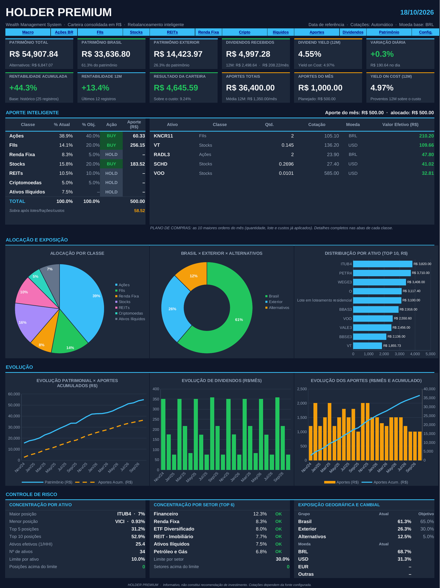

# 🏦 HOLDER PREMIUM · Versão Completa

### Gestão patrimonial **e** realocação inteligente, numa planilha só

[⬅️ Voltar ao projeto](../README.md)

<div align="center">



</div>

---

## 🧭 Para quem é

✅ **É para você se:**

- você quer **tudo em um lugar só**: carteira, aportes, dividendos, rentabilidade e histórico;
- você quer o **plano de compras do mês** e também **acompanhar a evolução** do patrimônio;
- você gosta de **dashboard completo**, com indicadores de renda passiva e de risco.

❌ **Talvez prefira a [🎯 Versão Simplificada](../Vers%C3%A3o%20Simplificada) se:**

- você já acompanha preço médio, dividendos e rentabilidade em outro app (MyProfit, por exemplo) e quer **só** o plano de compras.

## 📦 Arquivos

| Arquivo | O que é |
|---|---|
| 📗 [`HOLDER_PREMIUM.xlsx`](HOLDER_PREMIUM.xlsx) | Versão **limpa**, pronta para usar. Vem com objetivos de exemplo (40/20/20/10/5/5/0) e aporte de R$ 500, que você altera |
| 🧪 [`HOLDER_PREMIUM_DEMO.xlsx`](HOLDER_PREMIUM_DEMO.xlsx) | Mesma planilha com uma **carteira fictícia** (cerca de R$ 55 mil, com 2 anos de histórico) para ver tudo funcionando |
| 📘 [`HOLDER_PREMIUM_Manual_de_Preenchimento.pdf`](HOLDER_PREMIUM_Manual_de_Preenchimento.pdf) | Manual passo a passo (24 páginas) |

## ➕ O que a Premium tem a mais

| Recurso | Simplificada | **Premium** |
|---|:---:|:---:|
| Plano de compras com Rebalance Score | ✅ | ✅ |
| Macro Alocação, concentrações, controle de risco | ✅ | ✅ |
| **Preço médio** e **câmbio médio** por ativo | ❌ | ✅ |
| **Rentabilidade** por ativo, por classe e da carteira | ❌ | ✅ |
| **Histórico de Aportes** (até 2.000 lançamentos) | ❌ | ✅ |
| **Histórico de Dividendos** (até 3.000 lançamentos) | ❌ | ✅ |
| Renda passiva mensal, **Dividend Yield**, **Yield on Cost** | ❌ | ✅ |
| **Histórico Patrimonial** (até 10 anos) e rentabilidade acumulada, 12M e por ano | ❌ | ✅ |
| **Variação diária** da carteira | ❌ | ✅ |
| Gráficos de **evolução** (patrimônio, dividendos, aportes) | ❌ | ✅ |

## 🔁 Seu fluxo mensal

1. 🔄 **Atualize as cotações** (`Ctrl + Alt + F9` no Excel, `Ctrl + Shift + F9` no LibreOffice).
2. 💰 Em **13 Configurações**, digite o **Valor do aporte**.
3. 👀 Veja o **PLANO DE COMPRAS** no Dashboard (ou, em detalhe, a Macro Alocação e as abas das classes).
4. 🛒 **Compre no home broker.**
5. ✏️ **Atualize Quantidade e Preço Médio** dos ativos comprados.
6. 🧾 **Registre o aporte** em *10 Histórico de Aportes* e os **dividendos** em *11 Histórico de Dividendos*.
7. 📅 No **fim do mês**, registre o patrimônio em *12 Histórico Patrimonial*.

> 💡 **Novo preço médio** = (qtd. antiga × PM antigo + qtd. comprada × preço pago + custos) ÷ nova quantidade.
> Exemplo: tinha 100 ações a R$ 33,50 e comprou 20 a R$ 38,00 → PM = (100 × 33,50 + 20 × 38,00) ÷ 120 = **R$ 34,25**. Você pode digitar a conta direto na célula: `=(100*33,5+20*38)/120`.

## 🗂️ As 15 abas

| Aba | Função | Você preenche? |
|---|---|---|
| 📊 **01 Dashboard** | KPIs, plano de compras, gráficos e controle de risco | Não |
| 🎯 **02 Macro Alocação** | % objetivo por classe, BUY/HOLD e distribuição do aporte | % Objetivo |
| 🇧🇷 **03 Ações BR** · **04 FIIs** | Ações e FIIs brasileiros | Sim |
| 🌎 **05 Stocks** · **06 REITs** | Ações, ETFs e REITs do exterior | Sim |
| 🏦 **07 Renda Fixa** | Tesouro, CDB, LCI/LCA etc. | Sim |
| 🪙 **08 Criptomoedas** | BTC, ETH, SOL e outras | Sim |
| 🏠 **09 Ativos Ilíquidos** | Imóveis, terrenos, participações | Sim |
| 🧾 **10 Histórico de Aportes** | Cada aporte realizado | Sim |
| 💸 **11 Histórico de Dividendos** | Cada provento recebido | Sim |
| 📈 **12 Histórico Patrimonial** | Um registro por mês (Data e Patrimônio) | Sim |
| ⚙️ **13 Configurações** | Aporte, custos, câmbio e regras por classe | Sim |
| 📚 **14 Auxiliar** | Listas (setores é editável) e tabelas dos gráficos | Só os setores |
| 🗄️ **15 Base de Dados** | Tabela consolidada de todas as posições | Não |

> 🎨 **Células azuis** = você preenche. **Células escuras** = fórmulas (não edite).

## 🧾 Colunas que você preenche

### Abas de ativos (Ações, FIIs, Stocks, REITs, Cripto)

| Coluna | O que digitar | Exemplo |
|---|---|---|
| **Ticker** | Código, sem sufixo (`.SA` é automático) | `PETR4` |
| **Nome** / **Setor** | Livre / lista | Petrobras PN · Petróleo e Gás |
| **Moeda** | Vazio = moeda padrão da classe | *(vazio)* |
| **Quantidade** | O que você tem hoje | `100` |
| **Preço Médio** | Seu PM por unidade, na moeda do ativo | `33,50` |
| **Câmbio Médio** *(opc.)* | Dólar médio pago, em ativos do exterior. Vazio = câmbio atual | `5,30` |
| **Cotação Manual** | Plano B se a automática falhar | `37,10` |
| **Fech. Anterior Manual** *(opc.)* | Só para a variação diária no modo Manual | `36,80` |
| **Objetivo** | % do ativo **dentro da classe** (soma 100%) | `15%` |

Na **Cripto** há também o **ID CoinGecko** (`bitcoin`, `ethereum`, `solana`).

### Renda Fixa e Ilíquidos

Você informa **Valor Investido** e **Valor Atual** (e, na Renda Fixa, tipo, indexador, taxa e vencimento). Não há cotação automática.

### Históricos

| Aba | Colunas azuis |
|---|---|
| **10 Aportes** | Data · Classe · Ativo (opcional) · Valor (R$) · Observação |
| **11 Dividendos** | Data · Ativo · Tipo · Valor por cota · Quantidade · IR/Taxas · Câmbio (opcional) |
| **12 Patrimonial** | Data · Patrimônio (R$), **colado como valor**, um por mês |

## 📊 O que o Dashboard mostra

**12 indicadores:** Patrimônio Total · Brasil · Exterior · Dividendos Recebidos · Dividend Yield (12M) · Variação Diária · Rentabilidade Acumulada · Rentabilidade 12M · Resultado da Carteira · Aportes Totais · Aportes do Mês · Yield on Cost.

**6 gráficos:** alocação por classe · Brasil × Exterior × Alternativos · distribuição por ativo (top 10) · evolução patrimonial × aportes acumulados · evolução de dividendos · evolução dos aportes.

**Mais:** tabela de **aporte inteligente**, **plano de compras** (10 maiores ordens) e **controle de risco** (concentração por ativo, setor, geografia e moeda, com alertas).

## 📐 Como a rentabilidade é calculada

```text
Rentab. do mês = (Patrimônio − Patrimônio anterior − Aportes + Dividendos)
                 ÷ (Patrimônio anterior + Aportes ÷ 2)
```

- Aportes entram como fluxo de caixa; dividendos, como retorno. A rentabilidade acumulada **encadeia** os meses.
- **Reinveste dividendos?** Registre a compra **também** em *10 Histórico de Aportes*, senão o dividendo é contado duas vezes.
- **Rentabilidade 12M** só aparece a partir de **13 registros** mensais.
- Mantenha **um registro por mês** e em ordem cronológica.

## 🧠 Como o Rebalance Score decide

```text
Déficit  = máximo(0 ; Objetivo × (Patrimônio + Aporte) − Valor Atual)
Score    = Déficit do item ÷ soma dos déficits dos itens elegíveis
Aporte do item = Aporte × Score
```

Filtros em Configurações: **valor mínimo de diferença**, **máx. classes**, **máx. ativos por classe**, **compra mínima**, **lote** e **fração**. O que não couber nas ordens é **reaproveitado** no ativo de maior prioridade que ainda puder ser comprado.

## 🔌 Cotações

- **Automáticas** via Yahoo Finance (CoinGecko opcional para cripto), com a função `WEBSERVICE`.
- Funcionam no **Excel para Windows** e no **LibreOffice**. No **Excel para Mac e Web**, use o modo **Manual**.
- Ordem de preferência: **automática → Cotação Manual → Preço Médio** (nesse último caso, a coluna **Fonte** mostra `PM` em amarelo).
- Coluna **Fonte**: `Auto` ✅ · `Manual` · `PM` ⚠️ · `Sem cotação` ⚠️ · `Sem câmbio` ⚠️.

## ⚠️ Limitações

- 🌐 Cotações dependem de Yahoo Finance e CoinGecko (podem limitar ou falhar).
- 🧾 IOF (0,38%) e spread (1,5%) padrão vêm da planilha original. **Confirme com sua corretora.**
- 📅 O **histórico patrimonial é manual**: um registro por mês.
- 🏦 Renda Fixa e Ilíquidos: atualização manual do Valor Atual.
- 🧮 A sobra do arredondamento **não é redistribuída entre classes**: fica como **Sobra** para o próximo aporte.
- 📏 Capacidade: **920 posições**, 2.000 aportes, 3.000 proventos e 300 registros patrimoniais.

## ❓ FAQ

<details>
<summary><b>Qual a diferença para a Versão Simplificada?</b></summary>

A Simplificada só gera o plano de compras. A Premium faz o mesmo **e** controla preço médio, aportes, dividendos, rentabilidade e histórico patrimonial. Veja a tabela de comparação no início desta página.
</details>

<details>
<summary><b>Posso migrar da Simplificada para a Premium?</b></summary>

Pode. A estrutura das abas de ativos é parecida: copie ticker, quantidade e objetivo, e acrescente o preço médio.
</details>

<details>
<summary><b>Meu "Dividendo" aparece com classe "Não encontrado".</b></summary>

O ticker digitado no dividendo precisa ser **idêntico** ao cadastrado na aba da classe. Para ativos já vendidos, mantenha-os cadastrados com **Quantidade 0**.
</details>

<details>
<summary><b>A rentabilidade 12M mostra "n/d".</b></summary>

São necessários pelo menos **13 registros** mensais no Histórico Patrimonial. Continue registrando mês a mês (ou lance os meses anteriores, mesmo aproximados).
</details>

<details>
<summary><b>Posso apagar uma linha de ativo?</b></summary>

Não apague a **linha**. Selecione apenas as **células azuis** e aperte Delete. Excluir linhas quebra as fórmulas. Use `Ctrl + Z` se isso acontecer.
</details>

---

⚖️ *Material informativo e educacional, sem recomendação de investimento. Dados da DEMO são fictícios. Planilhas fornecidas sem garantias.*
